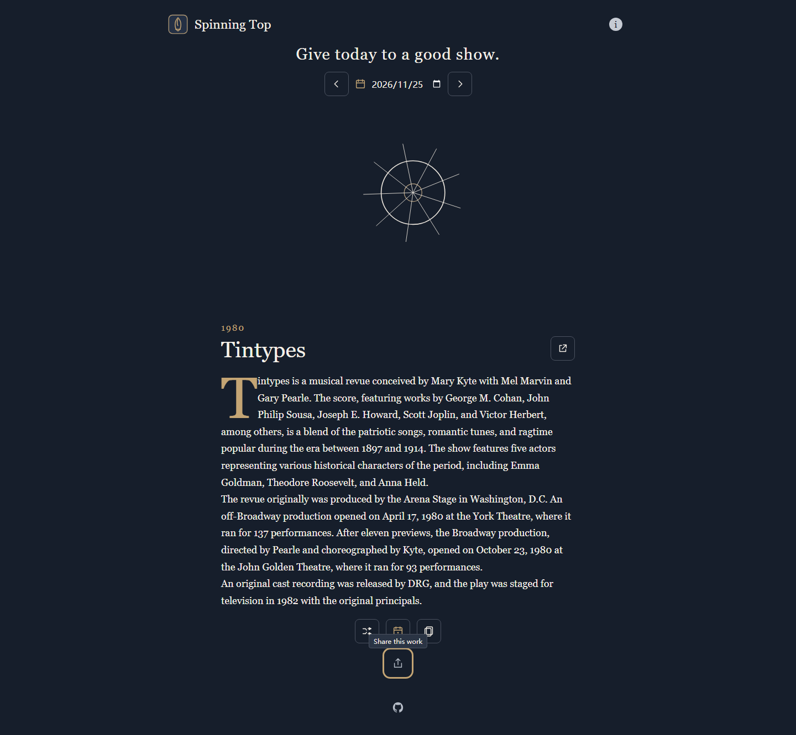

# Spinning Top

Discover one musical a day from a sourced catalogue, with persistent draws and Wikipedia summaries.

[简体中文与数据参考](README.zh-CN.md) · [Live site](https://styayur.github.io/musical-spinningtop/) · [Releases](https://github.com/styayur/musical-spinningtop/releases) · [Data provenance](docs/data-provenance.md)

**Experimental.** The bundled 25-09-2026 snapshot contains 2,650 titles. This is neither a complete worldwide musical catalogue nor a current-performance/ticket listing. Source categories include adjacent forms; metadata and available artwork vary.

Each show has an original offline SVG plate derived from its local title and summary. That plate is a conceptual drawing, not a plot reading, poster, or Wikipedia image. See [docs/artwork.md](docs/artwork.md).



## Use the web edition

Open the [GitHub Pages site](https://styayur.github.io/musical-spinningtop/). It needs no Python and uses `crypto.getRandomValues` with rejection sampling plus IndexedDB transactions. A day's first visit saves that day's draw; refresh and catalogue updates preserve it. Daily and free-draw modes each avoid repeats within their own cycle, but can overlap with each other.

Dates follow the browser timezone. An unopened past/future date gets its draw when first visited; this is not a historical performance archive. Tabs share browser storage, while devices/browsers have independent histories. Clearing site data resets them.

The site caches catalogue data after its first download and uses summaries from its published snapshot. It has no offline app shell: reopening without a network depends on the browser's page cache. Algorithm plates are part of the published files. Unverified remote covers are retained as source data and are not the main image. “Check catalogue updates” downloads a published snapshot; it does not crawl Wikipedia in the browser.

## Run locally

### Share a work

The share icon below the card actions opens device sharing (when supported), X, Facebook, WhatsApp, Threads, copy-link and save-card options. Sharing is always initiated by you; nothing is posted automatically. Platform previews may differ. Save the 1200 × 630 original-art PNG and attach it manually when a platform cannot attach an image from a link.

Each published work has a stable `works/<encoded-id>.html` URL. Opening it shows that work in a read-only mode, without drawing, consuming a cycle or changing a saved day. Choose **today** or **explore** explicitly to leave this mode. Unknown/removed works show an unavailable page; local-only works cannot advertise a public share link. Flask shares the published HTTPS URL, never localhost. Work pages contain Open Graph/X Card metadata directly in HTML.

The invitation and share controls follow the browser's preferred language: Chinese for `zh` variants, English otherwise. Work text and the rest of the interface are not automatically translated.

Read-only pages include the year, source links and text attribution/license without JavaScript. Leaving a shared work changes its URL and removes its work-specific preview metadata only after a successful draw response; a failed request preserves the shared page. Flask's bundled catalogue identifies candidate public links, **not confirmed deployments**: the sharing panel labels them unverified without contacting the public site. Local-only entries can save cards offline without a public URL. Only an index fetched from the actual public site confirms that it lists the work; this does not certify platform previews or individual resource availability.

Builds generate transparent version-5 artwork (extractor remains at version 4), work HTML and PNG cards offline. PNGs use content-hash filenames and a bundled SIL-OFL Noto Serif CJK font; no poster is copied. Pillow and resvg-py are installed by `requirements.txt`. The font stays in the source/build environment, not the deployed site. `build-metrics.json` records duration and output size. See [UI/sharing verification](docs/ui-sharing-review/verification.md) for measurements, screenshots and limitations; [v4 evidence](docs/artwork-review/) remains unchanged.

### Start Flask

Requires Python 3.9+; recorded maintainer validation used Windows/Python 3.14. macOS/Linux use `.venv/bin/python` in place of the Windows venv path.

```powershell
git clone https://github.com/styayur/musical-spinningtop.git
cd musical-spinningtop
python -m venv .venv
.venv\Scripts\python.exe -m pip install -r requirements.txt
.venv\Scripts\python.exe app.py
```

The Flask app listens on `127.0.0.1:5000`. Change port and suppress automatic browser opening with:

```powershell
.venv\Scripts\python.exe app.py 8000 --no-browser
```

`PORT`, `NO_BROWSER=1` and `SPINNINGTOP_DATA_DIR` also configure startup. The data directory defaults to `data/runtime`; preserve its SQLite database to keep draw history, cycles, cached details, and generated plates. Installs sharing that directory share daily results; draws use the host's local date.

The local app uses `secrets.choice` and SQLite `BEGIN IMMEDIATE` transactions. It can fetch details and refresh the catalogue directly from Wikipedia. Complete refreshes replace the catalogue; failures retain the old one. Startup attempts refresh when the local catalogue is over seven days old. Free draws use POST and are not blindly retried after uncertain network outcomes.

## Data and content boundaries

The bundled snapshot traversed 156 direct year categories under Wikipedia's Musicals by year, handled pagination, deduplicated page IDs and excluded 26 identified non-target entries from 2,676 candidates. The recorded result is 2,650. It does not recursively include musical-film categories or certify a uniform Broadway premiere year.

Summaries prefer Chinese Wikipedia, otherwise supplied Chinese or labelled English text. They are excerpts, not official synopses or new machine translations. Each item retains source links. Remote images remain externally linked and are not mirrored. They are shown as the main image only with an explicit verified-reuse mark; otherwise the page shows the original plate. Official links are limited to maintained entries; the Fever button performs a site search and does not establish current performances or ticket availability.

See [source/rebuild details](docs/data-provenance.md) and the [full reference](README.zh-CN.md#数据范围与来源). Run the offline validator before submitting catalogue changes:

```powershell
python scripts/validate_catalog.py
```

## Tests and static builds

This repository is the sole application upstream for future website integration. Build either mount from a pinned version with `python build_site.py --target github --output dist/github` or `python build_site.py --target personal --output dist/personal`. The personal output is designed for `/spinningtop/`; it is not a live deployment. GitHub's existing `.html` work links remain unchanged. See the [integration contract](docs/deployment-integration.md) for manifest verification, extensionless routes, CSP/404 requirements and offline Flask configuration, and [dual-target evidence](docs/portable-deployment/verification.md). Histories remain independent across origins.

```powershell
.venv\Scripts\python.exe -m unittest discover -s tests -v
.venv\Scripts\python.exe build_site.py
python -m http.server 8080 --directory _site
```

Optional browser tests require Python Playwright/Chromium. Start the local app separately before `browser_smoke.py`; drawing during tests writes history, so use isolated test data. `python scripts/artwork_review.py` regenerates the fixed visual sample; it is not required for CI.

```powershell
python -m pip install playwright
python -m playwright install chromium
python tests/browser_smoke.py http://127.0.0.1:5000
python tests/site_smoke.py
```

`site_smoke.py` expects the static build first. Tests cover reachability/non-repeating cycles, persistence/concurrency, offline initial data, error dates, update fallback, pagination and desktop/mobile interactions. Statistical checks are not proof of physical randomness.

[Pages workflow](.github/workflows/pages.yml) runs backend/browser tests and deploys after main pushes. A weekly Monday 04:23 UTC refresh attempts to rebuild the snapshot; failure retains the prior site. Its deployed `data/site-catalog.json` is not automatically committed, and old release datasets stay unchanged. Deployment includes public catalogue/assets/licenses, never local SQLite history.

## Contributing and roadmap

Read [CONTRIBUTING.md](CONTRIBUTING.md); use [Issues](https://github.com/styayur/musical-spinningtop/issues) for redacted reproductions and [SECURITY.md](SECURITY.md) for vulnerabilities. Catalogue additions need real source IDs and reviewed exclusions. Do not commit runtime databases or represent example/excerpt content as official material.

Catalogue-pipeline maintenance remains next work; extra discovery modes are future ideas. Audio streaming, copyrighted recording downloads and user accounts are outside scope. The web page no longer offers a local-download button; local running stays documented here.

## License

Program code uses [AGPL-3.0](LICENSE). Bundled Wikipedia text excerpts use [CC BY-SA 4.0](https://creativecommons.org/licenses/by-sa/4.0/) with original page/contributor history reachable through `intro_source`. Remote images retain individual terms and attribution at `image_source`; they are not downloaded into the bundle. Algorithm plates are program output and do not inherit Wikipedia image credit. Code licensing does not relicense content or grant image rights.
