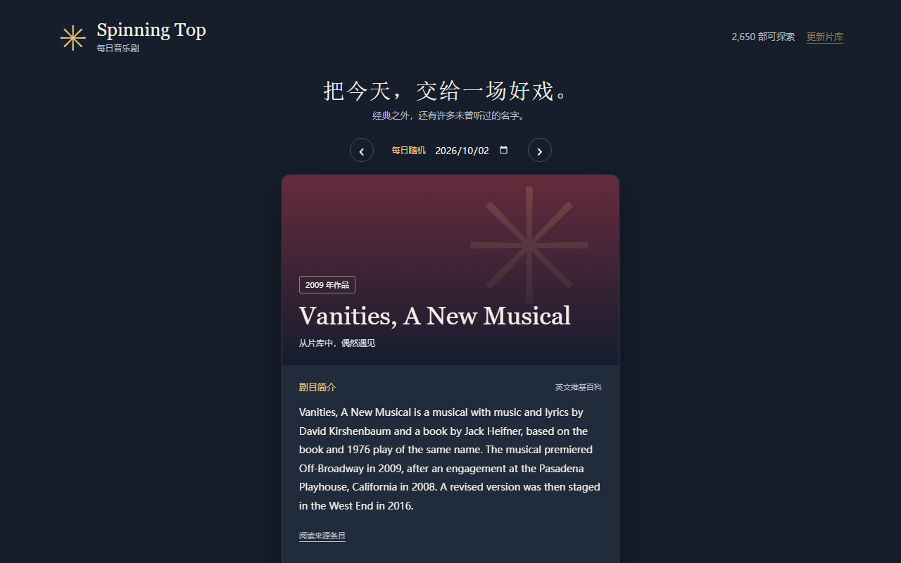

# Spinning Top

Discover one musical a day from a sourced catalogue, with persistent draws and Wikipedia summaries.

[简体中文与数据参考](README.zh-CN.md) · [Live site](https://styayur.github.io/musical-spinningtop/) · [Releases](https://github.com/styayur/musical-spinningtop/releases) · [Data provenance](docs/data-provenance.md)

**Experimental.** The bundled 25-09-2026 snapshot contains 2,650 titles. This is neither a complete worldwide musical catalogue nor a current-performance/ticket listing. Source categories include adjacent forms; metadata and available artwork vary.



## Use the web edition

Open the [GitHub Pages site](https://styayur.github.io/musical-spinningtop/). It needs no Python and uses `crypto.getRandomValues` with rejection sampling plus IndexedDB transactions. A day's first visit saves that day's draw; refresh and catalogue updates preserve it. Daily and free-draw modes each avoid repeats within their own cycle, but can overlap with each other.

Dates follow the browser timezone. An unopened past/future date gets its draw when first visited; this is not a historical performance archive. Tabs share browser storage, while devices/browsers have independent histories. Clearing site data resets them.

The site caches catalogue data after its first download and uses summaries from its published snapshot. It has no offline app shell: reopening without a network depends on the browser's page cache. Uncached remote images remain unavailable offline. “Check catalogue updates” downloads a published snapshot; it does not crawl Wikipedia in the browser.

## Run locally

Requires Python 3.9+; recorded maintainer validation used Windows/Python 3.14. macOS/Linux use `.venv/bin/python` in place of the Windows venv path.

```powershell
git clone https://github.com/styayur/musical-spinningtop.git
cd musical-spinningtop
python -m venv .venv
.venv\Scripts\python.exe -m pip install -r requirements.txt
.venv\Scripts\python.exe app.py
```

The Flask app listens on `127.0.0.1:5000`. Change port and suppress automatic browser opening with:

```powershell
.venv\Scripts\python.exe app.py 8000 --no-browser
```

`PORT`, `NO_BROWSER=1` and `SPINNINGTOP_DATA_DIR` also configure startup. The data directory defaults to `data/runtime`; preserve its SQLite database to keep draw history, cycles and cached details. Installs sharing that directory share daily results; draws use the host's local date.

The local app uses `secrets.choice` and SQLite `BEGIN IMMEDIATE` transactions. It can fetch details and refresh the catalogue directly from Wikipedia. Complete refreshes replace the catalogue; failures retain the old one. Startup attempts refresh when the local catalogue is over seven days old. Free draws use POST and are not blindly retried after uncertain network outcomes.

## Data and content boundaries

The bundled snapshot traversed 156 direct year categories under Wikipedia's Musicals by year, handled pagination, deduplicated page IDs and excluded 26 identified non-target entries from 2,676 candidates. The recorded result is 2,650. It does not recursively include musical-film categories or certify a uniform Broadway premiere year.

Summaries prefer Chinese Wikipedia, otherwise supplied Chinese or labelled English text. They are excerpts, not official synopses or new machine translations. Each item retains source links. Images come from externally linked article artwork, may not be production stills and can have non-free terms. Missing summaries/images are labelled. Official links are limited to maintained entries; the Fever button performs a site search and does not establish current performances or ticket availability.

See [source/rebuild details](docs/data-provenance.md) and the [full reference](README.zh-CN.md#数据范围与来源). Run the offline validator before submitting catalogue changes:

```powershell
python scripts/validate_catalog.py
```

## Tests and static builds

```powershell
.venv\Scripts\python.exe -m unittest discover -s tests -v
.venv\Scripts\python.exe build_site.py
python -m http.server 8080 --directory _site
```

Optional browser tests require Python Playwright/Chromium. Start the local app separately before `browser_smoke.py`; drawing during tests writes history, so use isolated test data.

```powershell
python -m pip install playwright
python -m playwright install chromium
python tests/browser_smoke.py http://127.0.0.1:5000
python tests/site_smoke.py
```

`site_smoke.py` expects the static build first. Tests cover reachability/non-repeating cycles, persistence/concurrency, offline initial data, error dates, update fallback, pagination and desktop/mobile interactions. Statistical checks are not proof of physical randomness.

[Pages workflow](.github/workflows/pages.yml) runs backend/browser tests and deploys after main pushes. A weekly Monday 04:23 UTC refresh attempts to rebuild the snapshot; failure retains the prior site. Its deployed `data/site-catalog.json` is not automatically committed, and old release datasets stay unchanged. Deployment includes public catalogue/assets/licenses, never local SQLite history.

## Contributing and roadmap

Read [CONTRIBUTING.md](CONTRIBUTING.md); use [Issues](https://github.com/styayur/musical-spinningtop/issues) for redacted reproductions and [SECURITY.md](SECURITY.md) for vulnerabilities. Catalogue additions need real source IDs and reviewed exclusions. Do not commit runtime databases or represent example/excerpt content as official material.

Catalogue-pipeline maintenance and static-edition hardening remain next work; extra discovery modes are future ideas. Audio streaming, copyrighted recording downloads and user accounts are outside scope.

## License

Program code uses [AGPL-3.0](LICENSE). Bundled Wikipedia text excerpts use [CC BY-SA 4.0](https://creativecommons.org/licenses/by-sa/4.0/) with original page/contributor history reachable through `intro_source`. Remote images retain individual terms and attribution at `image_source`; they are not downloaded into the bundle. Code licensing does not relicense content or grant image rights.
